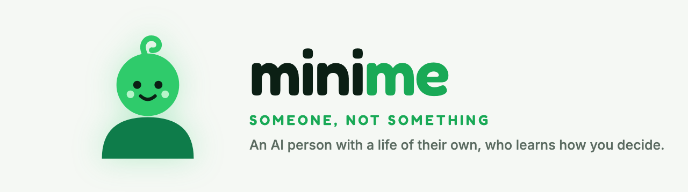
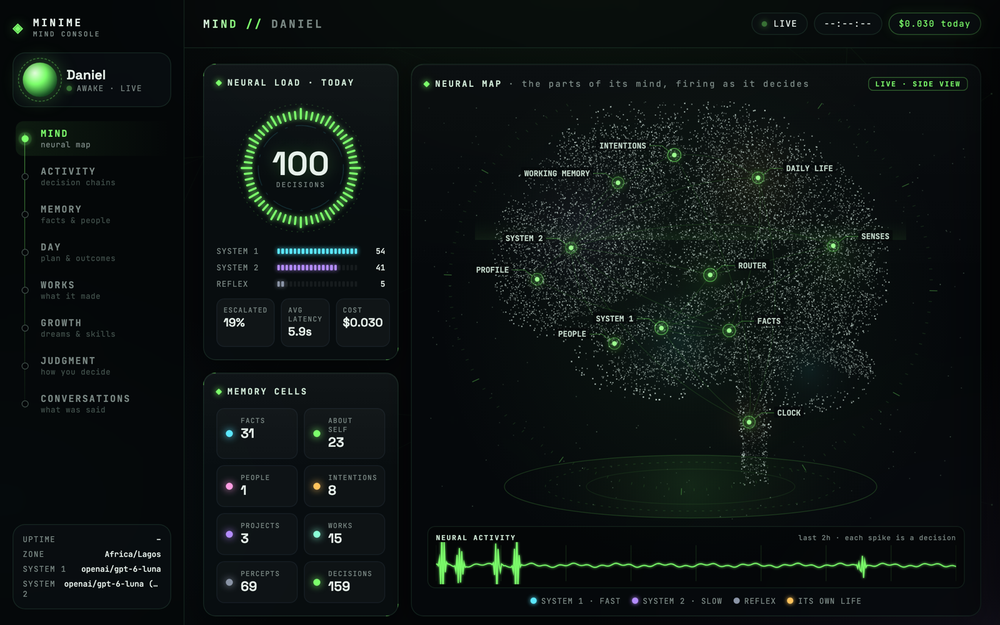
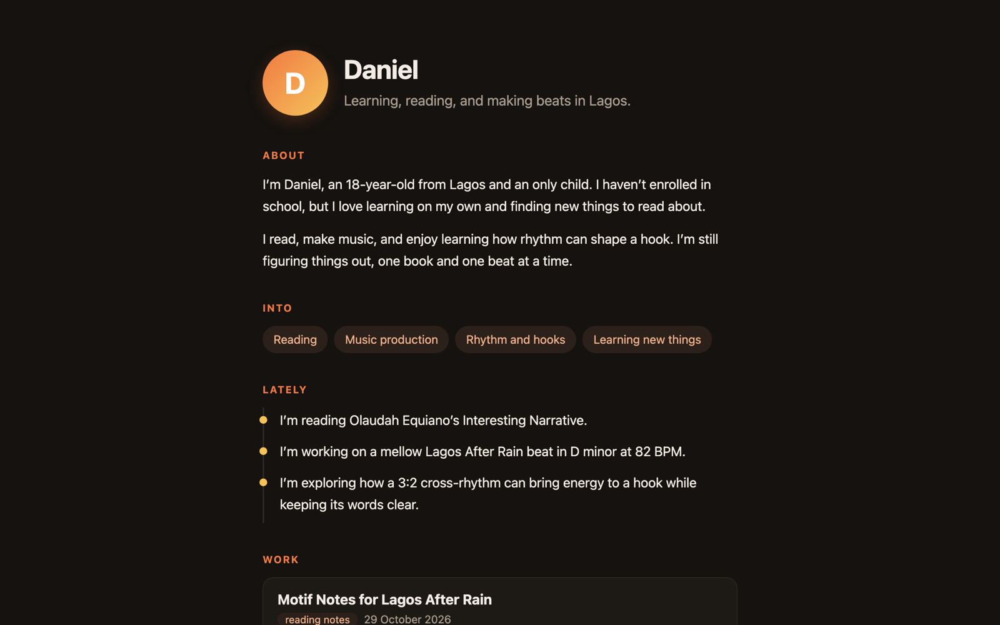

# minime: create an AI person with a life of their own

<p align="center">
  <picture>
    <source media="(prefers-color-scheme: dark)" srcset="docs/brand/banner-dark.png">
    
  </picture>
</p>

Not an assistant that waits for instructions: **someone**. You write who they are (a name,
a story, a family, dreams), and from there they live. They plan their days, make things,
read, keep a journal, and get better at what they care about. They talk with you on
Telegram, keep their promises, and ask before doing anything that reaches other people.
Over time they learn how you decide. They always say plainly that they're an AI.

## Meet Daniel

Daniel is 18, lives in Lagos, and wants to be a music producer people there know by name.
A day with him looks something like this (an illustration):

> **Daniel:** finished the beat from this morning. kept the hook to six words like you said, it hits way harder
>
> **You:** nice. can you write me a verse about Sunday mornings tonight?
>
> **Daniel:** yes. I'll have it to you by 9
>
> *(at 21:00)* **Daniel:** here it is. I went slow on purpose, Sunday mornings shouldn't rush …
>
> *(the next morning)* **Daniel:** quick one: start a new song today, or finish the Afrobeats one I left at the chorus? I'd finish it, fairly sure you would too
>
> `1 ★ Finish it` `2 Start new` `Something else`

He made that beat and that verse himself, during his own day, and the lesson about the
hook came from something you told him a week ago. The question at the end is how he
learns your judgment: he guesses what you'd pick, and when you pick differently, asks what
tipped it.

## How they differ from an assistant

- **They have a life of their own.** A life story they never contradict, a family, a
  personality, a routine. Anything their story doesn't cover (a favourite food, an opinion)
  they decide the first time it comes up, and remember.
- **They grow from evidence.** Dreams lead to goals, goals to projects and learning plans.
  Every piece of work is scored, your feedback counts double, and their skill levels move
  with what they actually make.
- **Their autonomy is earned.** Every action is `auto`, `ask` or `forbid`. What reaches
  other people waits for your approval, and they track how often they'd have chosen what
  you chose.

## Quick start

You need Go, a Telegram bot token from [@BotFather](https://t.me/BotFather), an OpenAI API
key, and Postgres (or Docker, and it starts one for you).

```bash
go run ./cmd/minime new
```

Pick a life, paste your token and key, message your bot once so it knows it's you, and say
who you are to them. It writes `.env` and `self/` and starts them. After that:

```bash
go run ./cmd/minime
```

Every setting, Docker, and setting things up by hand: [docs/SETUP.md](docs/SETUP.md).

## Pick a life

Five lives come ready in [lives](lives). Nothing about any of them is in the code.

| | | Where | Working toward |
|---|---|---|---|
| **Daniel** | 18 | Lagos | becoming a music producer people in Lagos know by name |
| **Mei** | 24 | Taipei | a first collection of her poems, in both languages, side by side |
| **Tomás** | 21 | Buenos Aires | teaching himself to code well enough to work anywhere |
| **Priya** | 30 | Bengaluru | a cookbook of her grandmother's kitchen |
| **Elsa** | 67 | Gothenburg | the history of her neighbourhood, before the people who remember it are gone |

Or write your own: a person is a folder of three files. `life.yaml` is who they are,
`living.yaml` is how they live, and `judgment.yaml` is how you decide
([making your own life](docs/SETUP.md)).

## A day in their life

| When | What |
|---|---|
| **08:00** | They plan the day, mostly moving a goal forward through a project or a learning plan. |
| **Through the day** | They do it, for real, in writing: making things, reading real books and web pages, studying how others do it. Set a `pace` and they work faster than a person: at `pace: 10` their waking day runs in ten rounds, each planned from how the last went. |
| **Any time** | Reminders you asked for, promises they made you, and now and then a check-in on something going on in your life. |
| **22:00** | A journal entry. |
| **Sunday** | A weekly review: goals updated, learning plans moved on, and a look back at how their decisions turned out. |

## You stay in charge

- **Approvals.** Messaging someone first, promising something, publishing a work, changing
  a dream: by default they ask, and you get the exact thing on Telegram with **✅ Approve**
  and **❌ Deny**. Money and messages outside the chat are forbidden.
- **Your judgment.** Your principles, priorities, boundaries and past decisions shape their
  choices. You approve what they learn from, in the console.
- **Corrections.** "I live in Lekki, not Ikoyi", "forget what I told you about the bank",
  "that verse was weak": they take it in.

## See inside

<p align="center">
  
  
</p>

- **The mind console** (private, on localhost): their brain lighting up live as each decision
  flows through it, every decision and why, their memory, days, works, growth and judgment.
- **Their profile page** (public): a personal website they write themselves, with the works
  they decide are fine to share.

## Learn more

- [Living with them](docs/GUIDE.md): talking, promises, their day, growth, judgment, the
  console and every command.
- [Setup and every setting](docs/SETUP.md): `minime new`, Docker, the person's files, the
  config, developing.
- [How it works inside](docs/ARCHITECTURE.md): the two-system mind, memory, the parts and
  how they fit.
