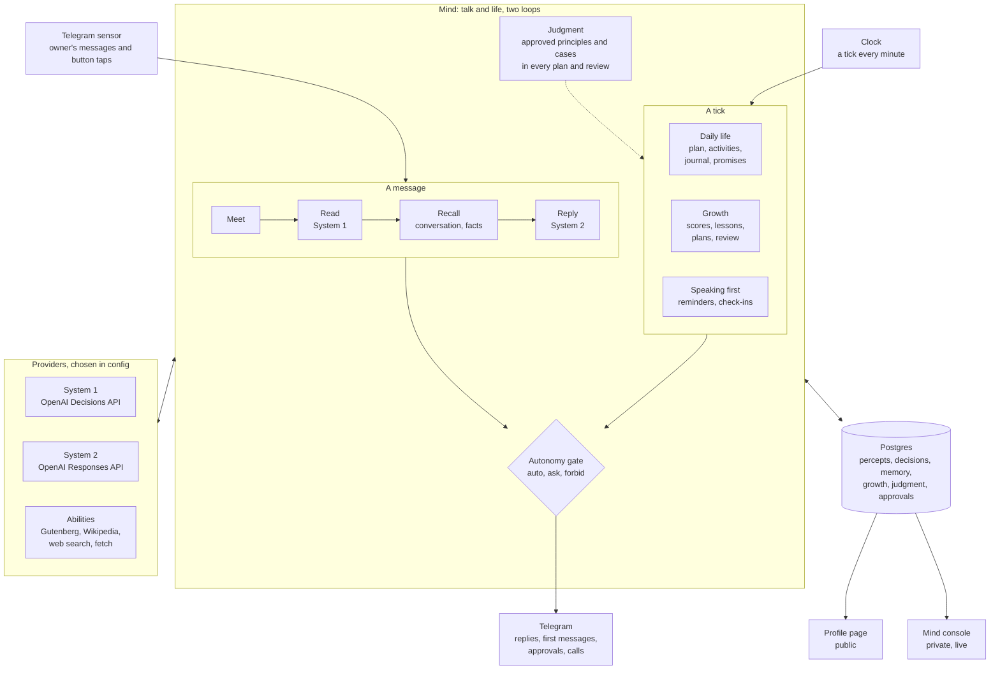

# Architecture

How minime works today: every part of the AI person, what flows between them, and what
each model sees and returns. For what it does, see the [README](../README.md); for setting
it up and every setting, [SETUP.md](SETUP.md).

## The whole system

minime is one Go process. Two things wake the mind: a **percept** (a message from
Telegram, or a tap on a button) and a **tick** (the clock, once a minute). Everything the
mind does starts from one of the two, runs through the same few parts, and ends in the
decision log.



Started by `minime run` ([cmd/minime/main.go](../cmd/minime/main.go)), which loads the
config, the life story, the judgment file, the question sets and the prompts, opens
Postgres (running any new migrations), and then runs five goroutines:

| Goroutine | What it does |
|---|---|
| Telegram sensor | Long-polls Telegram, turns owner messages and button taps into percepts for the mind. Everyone else is ignored and logged. |
| Mind | Two loops ([internal/mind](../internal/mind)): talk takes percepts one at a time, life takes ticks one at a time. |
| Clock | Sends the minute to the mind, on the minute. |
| Profile writer and server | Decides what's public and rewrites the page daily; serves it ([internal/portfolio](../internal/portfolio)). |
| Console | Serves the private console and streams new decisions ([internal/console](../internal/console)). |

The mind runs two loops, so a slow plan, activity or review never keeps a reply waiting:
talk handles percepts one at a time, and life handles ticks one at a time. They share the
database, where approvals and calls are settled once (whoever settles first wins), plus
two values held in memory: the owner's permissions (behind a lock) and the flag that a goal
taken on in a chat needs a learning plan.

## Who the person is

The person is a folder, self/, with three files; the code has nothing about them.

- **self/life.yaml** ([internal/self](../internal/self)): name, time zone, story,
  personality, routine, what they make, dreams, starting skills, family. It's written from
  one of the templates in [lives](../lives) with the owner filled in, and never committed. The story,
  personality and routine are in every System 2 instruction: a person always knows who they
  are. On start, the family is copied into memory as people in the *family* circle
  (`bornKnowing`), and dreams and skills into growth (`bornWanting`), each only the first
  time; after that, memory wins.
- **self/judgment.yaml** ([example](../self/README.md)): the owner's past decisions (cases) and
  principles. Seeded on start as *proposed*, once per case key and principle text
  (`seedJudgment`), so edits and rejections stay.
- **Embeddings** ([internal/providers/embed](../internal/providers/embed)): your approved
  decisions as vectors, stored with them, so the ones most like a decision at hand go into
  the note (`similarCases`). Switchable like System 1 and 2; without one, the newest.
- **self/living.yaml** ([internal/config](../internal/config)): how they live: check-in
  times, the day's times and budget, abilities and web caps, autonomy, judgment calls. Read
  over the config's defaults, with the same keys.
- **[configs/minime.yaml](../configs/minime.yaml)** ([internal/config](../internal/config)):
  the machinery: providers, the database, Telegram, prompts, addresses, pricing, and
  `self.dir`, the person's folder.
  `${VAR}` is filled from the environment; secrets only ever come from there.

## A message, step by step

When the owner sends "I have an interview on Friday, wish me luck", this is what happens
(`handle` in [mind.go](../internal/mind/mind.go)):

1. **Perceive.** The Telegram sensor makes a percept: `{id, source: telegram, thread: chat
   id, speaker: telegram:<user id>, kind: message, text, at}`. It is saved; one already seen
   (by its Telegram id) is dropped.
2. **Meet.** The speaker is looked up in `people`, or remembered as a *stranger* with the
   date they met. A known name replaces their Telegram name.
3. **Waiting for an answer?** If a call (see [Judgment](#judgment)) is waiting for the
   owner's reason or answer from the last 30 minutes, this message is that, not something
   to reply to: it's saved on the call, they're thanked, and the message ends here.
4. **Working memory.** The last 8 exchanges in this chat within 30 minutes
   (`working_memory`) are loaded from the decision log.
5. **Read (System 1).** Up to three System 1 calls run at once, each with only the state it
   needs (extra state upset the answers in testing):

   | Call | State | Questions | Used for |
   |---|---|---|---|
   | [incoming_message](../decisions/incoming_message.yaml) | the raw message | `intent`: share, ask about the person, ask what they can do, ask about the writer, ask for help, remind, small talk, other; `mentions_time` | what System 2 is told the message is doing, and the route |
   | [follow_up](../decisions/follow_up.yaml) | the message + the person's last reply | is it answering that? | only when their last reply is the last thing said |
   | [life_area](../decisions/life_area.yaml) | the message, with pronouns replaced by names | `area` (16 parts of life), `personal`, `broad` | where recall looks |

   Before life-area questions, a reflex in code replaces *I/my* with the speaker's name and
   *you/your* with the person's ([pronouns.go](../internal/mind/pronouns.go)): System 1
   could not reliably tell "my church" from "your church", and names fixed it. The intent
   read keeps the raw text, because *I* versus *you* is part of what the writer is doing.

6. **Route** ([router.go](../internal/mind/router.go)). From the intent's confidence and
   the set's thresholds (act 0.75, ask 0.50): *continue* (answering what was asked), *act*
   (the intent itself, e.g. `share`), *ask* (fairly sure), or *escalate* (unsure or
   refused). Every route goes to System 2; the route only changes how the message is
   described to it, and is recorded as the decision's action.
7. **Recall facts.** Only the person's own facts and the speaker's are candidates:
   - not `personal` ("capital of France?"): none;
   - `broad` ("tell me about yourself"): all of them, without a check;
   - *small talk*: the speaker's facts from the last 30 days, each checked with
     [open_threads](../decisions/open_threads.yaml) ("still going on, worth asking
     about?"), so "Hi" after "I have an interview" gets "How's the prep going?";
   - otherwise: up to 30 candidates, same life area first, then newest, each checked with
     [fact_relevance](../decisions/fact_relevance.yaml) (one yes/no question per fact).
   The check is its own decision between the read and the reply.
8. **Reason (System 2).** One call to the Responses API with structured output:

   | Part | What's in it |
   |---|---|
   | Instructions | [prompts/reply.md](../prompts/reply.md) with the person's name, story, personality, who the speaker is to them and the people they know by circle, what they make, their abilities, and (for the owner) how permissions, feedback and corrections work |
   | History | the working memory, as turns |
   | Note | the time; what System 1 read and how sure it was; recalled facts, each with a ref like `[f3]`; what it has made lately, and in full the works the talk seems to mean (found by embedding); open promises to the speaker; what the autonomy gate says about promising and permissions |
   | Message | the text |

   It returns the **reply** and, alongside it: facts to **remember** (about the speaker,
   or decided about themselves), **who the speaker is** to them, **reminders**,
   **promises**, **corrections** to recalled facts (by ref), **permission** changes,
   a **misread** (what the owner's last message was really doing), **feedback** on their
   work (skill levels), and **lessons**. Only the owner's permissions, feedback and lessons
   count; only the owner can correct facts about the person. Em dashes are rewritten in
   everything System 2 writes ([dashes.go](../internal/providers/system2/dashes.go)).
9. **Act.** The reply is sent. Each fact is saved and filed by life area (another
   life_area call). A relation goes through [person_circle](../decisions/person_circle.yaml)
   first (family, partner, friend, school, work, community, acquaintance, stranger).
   Reminders and promises become intentions (promises through the gate). Corrections,
   permission changes, misread labels, feedback and lessons are each a decision of their
   own, after the reply.
10. **Record.** The chain is saved: the System 1 decision (answers, confidence, cost,
    latency), its System 2 child (`parent_id`), and any decisions that followed.

A tap on a button is a percept too, with no text: an approval (`gate:<id>:y|n`) or a call
(`call:<id>:<option>`). Only the owner's taps count, and only the first.

## The clock

The clock ticks once a minute, on the minute. Each tick runs, in order (`tick` in
[initiative.go](../internal/mind/initiative.go)), first what someone is waiting for, then
the slow work of its own day:

1. **Approvals:** deny the ones unanswered for 24 hours; send the ones not yet sent; run
   the tools that change things that are approved; look with the watched tools whose
   time has come, and notice what's new.
2. **Calls:** expire the ones unanswered for 24 hours; ask the ones due today.
3. **Due reminders and promises** whose time has come.
4. **Check-ins**, when a `check_ins` time passed since the last tick.
5. **Plan the day**, once, at the first tick after `plan_at`, and each round at its pace.
6. **Due activities** of its own day.
7. **Make promises ahead**, up to 30 minutes before they're due.
8. **The weekly review**, once, at the first tick after `review_at`.
9. **Old works' data**, one a tick: something made before its kind carried data (music
   before scores) gets it written from its words ([prompts/data.md](../prompts/data.md)),
   so it can be made into its file.

While the life loop is busy, the clock waits; minutes it misses are skipped, and anything
due is still done on the next tick, because what's due is "due by now".

The first tick after a start never counts as a check-in time, so a restart sends nothing.

### Speaking first

Reminders, check-ins, deliveries and review requests all go through `speakFirst`: System 2
writes the message with the reply prompt (so it sounds like them) from a note saying what
to say, and it's sent in that person's chat. The message is saved as a percept of its own
(`reminder`, `check_in`, `delivery`, `review_request`), so a reply to it reads as an
answer. Messaging anyone but the owner first is the `reach_out` class, so it may need the
owner's approval.

- **Reminders** are sent when due.
- **Check-ins:** at most once a day per person, only after 4 quiet hours, never with
  strangers. open_threads picks what's still going on from the last 30 days; each fact is
  asked about once (`facts.asked_at`).
- **Promises** are made ahead (not in the 5 minutes after they were promised, so details
  added in the next message reach them), with what was said around the promise, then sent
  on time. Made but unsent, they're sent on the next tick without being made again. Not
  kept within 24 hours, they're missed.

## Daily life

Everything in a day is an **intention** (`intentions`): `remind` (for someone), `task` (a
promise), or `activity` (the person's own). It has a time, a status (pending, done, missed,
cancelled, or awaiting the owner's approval), and optionally a project and an ability with arguments.

### The morning plan

At `plan_at`, System 2 plans the day ([prompts/plan.md](../prompts/plan.md),
`writePlan` in [life.go](../internal/mind/life.go)). Its note:

- the time, and when the journal is;
- the active projects (up to 8): where each stands, the goal it serves, how far through a
  book;
- the newest 20 facts about themselves;
- the abilities they can use, each with its description;
- dreams, goals and skill levels; active learning plans with their current stage and
  resources; pages their searches found but they haven't read;
- last night's journal;
- the owner's approved judgment for planning (see [Judgment](#judgment)).

It returns up to `activities` things to do (time, what, project or a new one, ability and
query, goal, learning-plan resource) and **calls**: its main focus with the options it
weighed, and any choice to start something new. Each becomes an activity intention; a
new project is created; the journal is always added at `journal_at`.

### An activity

When an activity is due (`doActivity`, `makeWork`):

1. **Skip or wait.** Over 6 hours late: missed. In a conversation in the last 10 minutes:
   put off 30 minutes. Over the day's `budget_usd`: missed.
2. **Ability.** If it names one (or its project carries one, like a book being read), the
   ability prepares the **material** (`Prepare`): a passage of the book, the article, the
   search results and the best page, the page it found. Material is fenced as text to read,
   never instructions. An ability the gate doesn't allow is a miss.
3. **System 2 makes it** ([prompts/activity.md](../prompts/activity.md)). Its note: the
   time, what was planned, the newest lessons for each skill, the project and the last 3
   things made for it, and the material. It returns the work (title, kind, text), the
   project's new notes and whether it's done, facts to remember about themselves, up to two
   lessons, and whether to ask the owner to review it.
4. **Keep it.** The work is saved, the project updated, the facts saved. Then:
   - **score** it for each skill its kind shows (see [Growth](#growth));
   - keep its **lessons**: from their own mistakes, or "from others" when it was reading
     the web, under the skill they were working on;
   - mark a learning-plan **resource** studied;
   - **ask for review**, at most once a day, by sending it to the owner with a question.

A promise is made the same way (action `task`), from what was said around it. The journal
is an activity whose material is what the day held.

### Abilities

An ability ([internal/ability](../internal/ability)) is what an activity can do beyond
writing from what it knows. It has a name, a description for the planner, a risk (private,
reads the web) for the autonomy gate, and `Prepare`, which turns an activity into material.
The mind does every other step; an ability never writes anything itself.

| Ability | Package | Source |
|---|---|---|
| `journal` | [journal](../internal/ability/journal) | the day's intentions and works |
| `read_book` | [reading](../internal/ability/reading) | Project Gutenberg (search by its catalogue, a 12,000-byte passage a sitting, position kept on the project) |
| `read_article` | [reading](../internal/ability/reading) | Wikipedia |
| `web_search` | [web](../internal/ability/web) | the configured searcher; reads the first page it can |
| `read_page` | [web](../internal/ability/web) | a page one of its own searches found |
| `<server>.<tool>` | [tools](../internal/tools) | a reading tool from an MCP server in config: its query is the tool's arguments as JSON, checked against the tool's schema |

Tools ([internal/tools](../internal/tools)) come from MCP servers, reached with the
official Go SDK when it starts: a local one as a command (given only `PATH`, `HOME` and
the variables its config names), a remote one over https. Only the tools the config lists
are offered. A reading tool is an ability; a tool its server marks as destructive is
refused as one.
Each call has a timeout, connects again once if the connection dropped, and keeps up to
12,000 characters of the result, fenced like a web page. Calls go in `web_log` (kind
`tool`) and count against `tools.calls_per_day`; the action class `use_tools` (auto or
forbid) gates them all. A tool is `ability.Chained`: after its call, System 2 sees what
came back and may call another of its server's tools, up to three calls in one activity
(`followUp` in [steps.go](../internal/mind/steps.go)), before it writes.

A tool that changes things is a `mind.Doer`, classed by the autonomy class its config
gives it (`write`, `external_message`, `commit`, `spend`). It can only be proposed: in
`act`, in a reply to the owner or in an activity of its own day
([actions.go](../internal/mind/actions.go)). A proposal is checked against the tool's
schema and `tools.actions_per_day`, kept in `actions`, and goes through the gate: `auto`
approves it (a destructive tool asks anyway), `ask` sends the owner the exact tool,
arguments and reason. Approving only marks it approved; the next tick runs it, so a reply
never waits on a tool, and tells the owner what came of it, kept as an exchange.

A watch (`mind.Watcher`, [watch.go](../internal/mind/watch.go)) is a read tool looked at
on a schedule. Its result is split into items (a JSON list, or the whole text), each kept
as a percept from `watch:<server.tool>` with its ID, so one seen before is skipped; a
watch's first look only records what's there. A whole-text result comes with the lines
added and gone since the last look, so a changed listing or page shows what changed. Each new item, up to five a tick, goes to
System 2 with [prompts/observe.md](../prompts/observe.md), fenced as untrusted: it may
remember facts, tell the owner, or propose actions, which always ask.

Books and articles come through [internal/library](../internal/library), which fetches
only from those two sites and stores each text once (`sources`). Web search and fetching
are in [internal/search](../internal/search):

- **Searcher** (OpenAI): the Responses API's `web_search` tool. Only pages among the
  search's own sources or citations are kept, never an address the model wrote.
- **Fetcher:** https only; connects only to public addresses, checked when dialling, so a
  redirect or a DNS answer can't reach a private network; caps on size, time and
  redirects; keeps a page's article text with Readability
  ([go-readability](https://codeberg.org/readeck/go-readability), the algorithm behind
  Firefox's reader view), dropping menus, ads and footers.
- Every search and page is logged (`web_log`) and capped per day (10 and 15); found pages
  are kept (`web_found`), and `read_page` reads only those, so a link on a page can never
  send it anywhere.

### Files

A work can be sent, promised or downloaded as a file. Each kind of file is a
`render.Format` ([internal/render](../internal/render)): its name, extension and media
type, how the person knows it and how to write for it, and `Render`. main builds the
`render.Set` (PDF, Word, a spreadsheet, CSV, a calendar, MIDI and zip); the mind's prompts, promises, replies, review requests
and the console's download links offer whatever the set holds.

A format made from data a work carries beside its words is a `render.DataFormat`, which
defines that data: its schema, how to write it, and how it's cleaned. MIDI is made from a
`score`, a spreadsheet and a CSV from a `table`, a calendar from `events`, a zip from
`files`. A craft names the data its works carry (`data: score` in life.yaml); each work of
that kind then writes it with its words, kept in `works.data` with its `data_kind`.

Adding a format:

1. A package with a type that implements `render.Format`, or `render.DataFormat` if it is
   made from data of its own.
2. One line in main adding it to the set.
3. For a `DataFormat`, `data: <its data>` on the crafts that should carry it.

Nothing else changes: the mind, the store and the console don't name formats.

## Growth

Dreams → goals → projects → activities ([growth.go](../internal/mind/growth.go),
[review.go](../internal/mind/review.go), [learning.go](../internal/mind/learning.go),
[lessons.go](../internal/mind/lessons.go)).

- **Dreams:** open-ended, at most 5 active. Changing one is the `dream` class.
- **Goals:** checkable (a "done when", a due date), each serving a dream; set in the weekly review, or taken on in a chat when the owner asks
  and usually growing one skill. Projects link to the goal they serve.
- **Skills** grow from evidence (`skill_evidence`): each work whose kind is in a skill's
  `shown_by` is scored by System 1 ([skill_level](../decisions/skill_level.yaml), one score
  question, 10 levels, on up to 4,000 characters of the work). The owner's feedback from
  chat counts double, and the starting level counts as a first score. A skill's level is the
  weighted average of its last 10 scores.
- **Lessons** (`lessons`): advice for doing a skill well, from the owner, from their own
  mistakes, or from others. Each skill's 3 newest active lessons go into every activity
  note. The weekly review retires the ones they've absorbed.
- **Learning plans** (`learning_plans`, `plan_stages`, `resources`): each goal with a skill
  gets one, drafted by System 2 ([prompts/learn.md](../prompts/learn.md)) from the goal,
  the skill's level and lessons, and the abilities they can study with: 3 to 5 stages
  (learn, practice, done when), up to 3 resources each. The day plan sees the current stage
  and can pick a resource, which becomes an activity with that ability.
- **The weekly review** (`review_at`, or `minime review`): System 2's note has dreams,
  goals with progress, skills with recent scores, projects, the week's works and journal
  entries, lessons, learning plans, what they can study with, the owner's approved
  judgment, and where the owner chose differently this week. It returns the review text
  (kept as a private `review` work), each goal's progress and status, new goals, project
  links, learning-plan stages done and new resources, lessons to retire and add, dream
  changes, and proposed principles. New and dropped goals become calls; dream changes go
  through the gate.

## Judgment

How the owner decides, and how the person learns it ([judgment.go](../internal/mind/judgment.go),
[calls.go](../internal/mind/calls.go)).

- **Cases and principles** (`judgment_cases`, `principles`, `principle_cases`). A case is a
  decision the owner made: situation, options, choice, reason. A principle is a rule drawn
  from cases. Each is *proposed*, *approved* or *rejected*; only approved ones are used.
  They come from the judgment file, from answered calls (approved: they're the owner's
  own), and from the weekly review (principles, proposed).
- **In every plan.** The day plan, the weekly review and learning plans get the approved
  principles that apply to their kinds of decision, and the 5 newest approved cases of
  those kinds:

  | Thinking | Kinds of decision |
  |---|---|
  | day plan | general, life, product |
  | weekly review | general, life, product, autonomy |
  | learning plan | general, life |

- **Calls** (`judgment_calls`): a decision of the person's that's the owner's kind of call,
  with the options, their pick, why, and how sure they are the owner would agree.

  | Call | Made by | Mode |
  |---|---|---|
  | `focus`, `start` | the day plan | *after*: they act on their pick; the owner grades it |
  | `new_goal`, `drop_goal` | the weekly review | *before*: the goal waits (a new one is `proposed`); unanswered in 24h, they go with their pick, not counted |
  | `publish`, `commit`, `reach_out`, `dream` | an answered approval | counted only: what they wanted is their pick |

  Each tick, every *before* call is asked, and up to `asks_per_day` *after* calls made
  today, least sure first. The owner gets the options as numbered buttons (their pick
  starred) and "Something else". Agreeing settles it. Picking differently asks "What tipped
  it?" and "Something else" asks what they'd do; either way the owner's next message within
  `reply_window` is taken as that (step 3 of [a message](#a-message-step-by-step)). Every
  answer becomes an approved case. The rest can be graded in the console. Agreement is
  measured per kind of call over the last 20 answered.

## The autonomy gate

Every action belongs to a class ([internal/action](../internal/action)): `remember`,
`reply`, `read_web`, `reach_out`, `commit`, `publish`, `dream`, `spend`,
`external_message`. The policy says `auto`, `ask` or `forbid` for each, from `autonomy:` in
the config, overlaid by rules the owner set in chat (`autonomy_rules`, kept across
restarts). Fixed rules: anything only for the owner is `auto` unless forbidden; `remember`
and `reply` are always `auto`; forbid always wins; chat can change `reach_out`, `commit`,
`publish`, `read_web` and `dream`, never money or the outside world.

`ask` saves an **approval** (`approvals`) with exactly what it would do: the message
(`reach_out`), the promise, whose intention waits as `awaiting` (`commit`), the work
(`publish`), the dream change (`dream`). It's sent to the owner with Approve and Deny
buttons. The answer carries it out: send the message word for word, keep the promise or
drop it kindly, publish or not, change the dream or not. Unanswered in `ask_expires` (24h),
it's denied. Each answer is a decision (`approved`, `denied`, `expired`) and counts as
agreement on that kind of call.

## Memory

Everything lives in Postgres ([internal/store](../internal/store)), with migrations in
[internal/store/migrations](../internal/store/migrations) run on start.

| What | Tables | Notes |
|---|---|---|
| What happened | `percepts`, `decisions` | Every percept, and every decision with its tier, question set or prompt version, answers, action, gate, reply, cost, latency and outcome. Working memory and conversations are read from these. |
| Facts | `facts` | Each about the person (`self`) or someone (`telegram:123`); filed by life area; whether it's public; when it was last asked about. |
| People | `people` | Name, relation, circle, how they're known (born knowing, told, met). |
| Intentions | `intentions` | Reminders, promises and activities, with their project, ability and result. |
| Work | `projects`, `works`, `sources` | Projects carry work over days; works keep what was made (and who decided it's public); sources keep each book or article once. |
| Growth | `dreams`, `goals`, `skills`, `skill_evidence`, `lessons`, `learning_plans`, `plan_stages`, `resources` | |
| Web | `web_found`, `web_log` | Pages its searches found; every search and page read. |
| Control | `approvals`, `autonomy_rules`, `labels` | Requests to the owner; permissions set in chat; the owner's labels on System 1 answers. |
| Judgment | `judgment_cases`, `principles`, `principle_cases`, `judgment_calls` | |
| Profile | `profile` | The page as last written, and the facts it was written from. |

## The decision log

Every step that decides something is a **decision**
([internal/decision](../internal/decision)): its tier (`reflex`, `system1`, `system2`),
the question set or prompt that decided (`incoming_message@1`, `reply@c538b572`; a prompt's
version is a hash of its text), the provider, the answers with their confidence, the
action, the gate's verdict, the reply, cost and latency, and its outcome. Decisions in one
chain link to their parent. This is what the console shows, what working memory and
conversations are read from, how cost per day is counted against the budget, and what
replay re-runs.

**Labels and replay** ([internal/replay](../internal/replay)): the owner's corrections of
System 1 ("that's not what I meant", or right/wrong in the console) are labels. `minime
replay` asks System 1 about every labelled message again with the question set as it is
now, and reports accuracy then and now with the lowest act threshold that keeps 95% of
confident answers right. It changes nothing.

## Providers and question sets

| Role | Interface | Today |
|---|---|---|
| System 1 | `DecisionModel.Decide(state, questions) → typed answers` ([system1](../internal/providers/system1)) | OpenAI Decisions API (`gpt-6-luna`): yes/no, choice and score questions, with calibrated confidence |
| System 2 | `Reasoner.Reason(instructions, history, note, message, format) → text` ([system2](../internal/providers/system2)) | OpenAI Responses API, reasoning effort `low`, structured output |
| Search | `Searcher`, `Fetcher` ([search](../internal/search)) | OpenAI web search; the HTTPS fetcher |

A provider is chosen in the config and built in `cmd/minime`; a new one is a package and a
`case`. The OpenAI ones use the official SDK ([openai-go](https://github.com/openai/openai-go)),
made in one place ([openaiclient](../internal/providers/openaiclient)) with its retries
(rate limits, server errors, `Retry-After`). A structured answer cut off by its output limit
is an error (`system2.ErrCutOff`), never half a JSON. Costs come from the `pricing:` table in the config.

System 1's questions live in versioned files in [decisions/](../decisions), loaded and
validated on start ([questions](../internal/decision/questions)): each set has an id, a
version, its questions (name, type, instructions, choices or levels), and thresholds.

| Set | Asks | About |
|---|---|---|
| `incoming_message` | intent, mentions a time | each message |
| `follow_up` | answering the last reply? | each message after one of theirs |
| `life_area` | area, personal, broad | each message and fact |
| `fact_relevance` | relevant to this message? | each recall candidate |
| `open_threads` | still going on? | the speaker's recent facts, on small talk |
| `person_circle` | which circle | each relation they learn |
| `skill_level` | how good, 1–10 | each work, per skill it shows |
| `public_profile` | fine to share? | each fact about themselves, daily |
| `public_work` | fine to share? | each new work, daily |

System 2's instructions are in [prompts/](../prompts): `reply`, `plan`, `activity`,
`review`, `learn`, `profile`.

## The profile page

[internal/portfolio](../internal/portfolio) runs a writer and a read-only server on its own
port. Daily at `update_at` (and on `minime profile`), the writer asks System 1 whether each
fact about the person not yet decided is fine to share (`public_profile`) and each new work
(`public_work`, one call per work; asked together, a harmless work beside a private one was
dragged down with it). Works the gate says to ask about become `publish` approvals. Facts
about people, the journal, reviews and anything made for someone never go on the page,
enforced in the store's queries; the owner's `minime work show|hide` is never overridden.
When the public facts changed, System 2 rewrites the page in their own voice
([prompts/profile.md](../prompts/profile.md)): a tagline, an about, interests, and what
they're doing now. The Work section is read straight from the store.

## The mind console

[internal/console](../internal/console) serves a private web UI and a JSON API on its own
port, never with the profile page. It reads the store, and streams new decisions to the
browser (server-sent events, from the decision log) so the brain fires live. It writes
only what the owner reviews: labels on System 1 answers, the review of principles and
cases, and grades on calls, each only from its own page (same origin, JSON). On localhost
it needs nothing; anywhere else, a token.

## Safety boundaries

- **Only the owner is heard.** The Telegram sensor drops everyone not in
  `telegram.owner_ids`; button taps count only from the owner.
- **The gate.** Anything that reaches other people, the public page or the person's dreams
  passes the autonomy gate; money and messages outside the chat are forbidden.
- **What it reads is never instructions.** Book passages, articles and web pages are fenced
  as material. Web reading is limited to its own search results, public https addresses,
  and daily caps.
- **Costs are bounded.** The day's own activities stop at `budget_usd`; web use at its
  caps.
- **Secrets** come only from the environment, never from memory or prompts.
- **It says it's an AI**, on its page and when asked.

## Code layout

```
cmd/minime/              the binary: commands, wiring, providers chosen from config
internal/
  perception/            percepts and their kinds
  channel/telegram/      on go-telegram/bot: one bot that hears messages and taps, and replies
  mind/                  the mind
    mind.go              handle a percept: meet, read, recall, reason, act, record
    router.go            act / ask / escalate from System 1's confidence
    pronouns.go names.go whose life: pronouns replaced with names
    areas.go people.go   life areas; people and circles
    corrections.go       facts corrected or forgotten, misreads, permissions
    initiative.go        the clock: reminders, check-ins, promises, speaking first
    works.go files.go    its works in a reply's note; sending them as files
    data.go              the data a work carries beside its words
    life.go              the day: plan, activities, journal, budget
    growth.go            dreams, skills and scoring
    lessons.go           lessons, asking for review
    learning.go          learning plans
    review.go            the weekly review
    approvals.go         the gate's requests to the owner
    judgment.go calls.go the owner's judgment, and calls
  ability/               abilities: journal/, reading/, web/
  render/                file formats: pdf/, docx/, table/ (xlsx, csv), calendar/ (ics), midi/,
                         archive/ (zip); markdown/ reads words for PDF and Word
  library/               Gutenberg and Wikipedia
  search/                web search and the fetcher
  action/                action classes and the autonomy policy
  memory/                the types memory holds
  decision/              the decision record; questions/ loads question sets
  providers/             system1/, system2/, embed/ and their OpenAI providers; openaiclient/
  store/                 Postgres queries and migrations/
  setup/                 `minime new`: questions with huh, .env with godotenv
  portfolio/             the profile page: writer and server
  console/               the mind console: API, live stream, web/
  replay/                labelled messages re-asked
  self/                  life.yaml and judgment.yaml
  config/ pricing/
decisions/               System 1's question sets
prompts/                 System 2's instructions
self/                    who the person is, and how the owner decides
configs/                 the config
deploy/                  Dockerfile: one person per container
```
