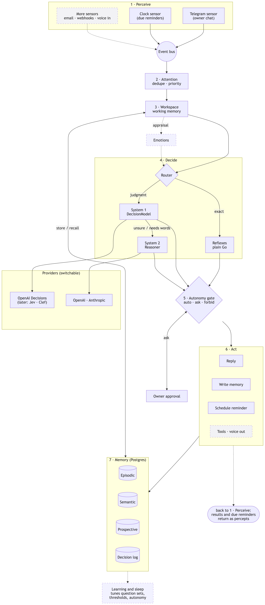
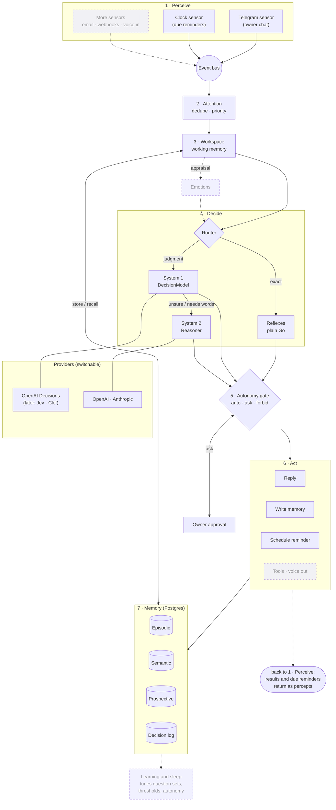

# mini-me — Architecture & Feature Outline

> A long-running, always-on agent written in Go. Its structure is borrowed from how a human
> works: perceive, filter, decide (mostly fast and intuitively, sometimes slowly and
> deliberately), act, remember, learn. v1 borrows the *structure* only. Emotions come
> later, together with a voice (§4.9). Simulated flaws such as fatigue or mistakes are not planned.

Status: **v1**

## What mini-me is

mini-me is **a person in its own right**, not an assistant. It has its own life: a name,
an age, a religion, a school, a family, opinions. It meets people and talks to them. The
human running it is **one person it knows**, someone it talks to and learns about, not the
subject of its life.

It remembers on two sides, as a person does:
- **About itself.** Its life story, written once by its creator in
  [self/life.yaml](../self/life.yaml), is who it is, and it never contradicts it. Everything
  else about itself it decides when it first comes up, like a person forming an opinion. If
  asked its favourite food and it has never thought about it, it picks one that fits its
  life, says it, and remembers it, so it answers the same way from then on.
- **About the people it knows.** What they tell it about themselves, filed per person.

Every fact has a **subject**: the agent itself, or a specific person. System 1 decides for
every message **who it is about**: "What is your church?" is about the agent and religion;
"What is my church?" is about the person speaking and religion. Recall then looks in the
right memory.

For now it talks only to its creator, as a known person. People are identified per channel
account, so others can be introduced later. The *owner* role remains only for control: who
may configure or stop it.

**People live in its memory** (`people` table, `internal/mind/people.go`), the way they do
for a person. Nothing about them needs a restart:
- **Born knowing its family:** the `family` list in `self/life.yaml` (name, relation, and an
  account only for relatives who talk to it) goes into memory as *family*, each the first
  time it appears. A person knows their mother and cousins whether or not they ever talk to
  them, so relatives without an account are known too. After that, memory wins: the file
  never changes a known relative, and a claim never overwrites them.
- **Met:** someone who talks to it for the first time is remembered as a *stranger*, with the
  date they met.
- **Told:** when someone says who they are to it ("I'm your cousin"), System 2 returns that
  relation alongside its reply, and it's stored.
- **Circles:** before a relation is stored, System 1 files the person into a circle of its
  life ([person_circle](../decisions/person_circle.yaml)): family, partner, friend, school,
  work, community, acquaintance, stranger. A replay of 13 relations was 13/13 right.
- Every System 2 reply is told who it is talking with and lists the people it knows, by
  circle. Only what it was born knowing is stated as certain.

## Decisions made

| Topic           | Decision |
|-----------------|----------|
| What it is      | **A person with its own life**; the human is someone it knows (see above) |
| Its life        | **Written by its creator** in `self/life.yaml`, then grows: unknown details about itself are **decided and remembered** |
| Who it talks to | **Its creator only, for now**, as a known person; built for more people later |
| Scope           | Start with the tiniest useful purpose (§2), then grow it in small steps |
| Single vs many  | **A single mind** for now |
| Fidelity        | v1 borrows the human *structure* only. **Emotions are planned for later**, with the voice model (§4.9) |
| Fast decisions  | A **System One decision model** (Jev, Clef, OpenAI Decisions…), behind a provider interface |
| Slow decisions  | A **reasoning LLM** (Claude, OpenAI, Gemini, local…), behind a provider interface |
| Providers       | **Switchable through config**, never hard-coded |
| Rules engine    | **None.** A System One decision model covers that role |
| Autonomy        | **Configurable**, starting at "ask before acting" and widened over time |
| First purpose   | **A person you can talk to, who knows itself and remembers you** (§2) |
| Channel         | **Telegram** |
| System 2 default | **OpenAI** (model set in config) |
| System 1 default | **OpenAI Decisions API** (`gpt-6-luna`); Jev is added later as another provider, chosen in config |

---

## The mind at a glance

How every component connects. Solid boxes exist now or are next on the roadmap; dashed
boxes are planned for later.



Also available as [SVG](mind-diagram.svg). The Mermaid source below is what the images are
rendered from: edit it, then re-export the images.

<details>
<summary>Mermaid source</summary>



</details>

**Reading it top to bottom:**
1. **Perceive:** sensors turn the world into percepts on the bus.
2. **Attend:** attention drops duplicates and noise, and stores what's left as episodes.
3. **Workspace:** relevant memories are recalled into working memory. Later, the workspace is
   also appraised to update emotions, which feed the router.
4. **Route:** the router picks reflex, System 1 or System 2. System 1 escalates to System 2
   when its confidence is low or the answer needs words.
5. **Gate:** every chosen action passes the autonomy gate, which may ask you first.
6. **Act:** actions reply, write memory or schedule reminders. Their results flow back as new
   percepts, and due reminders come back in through the clock.
7. **Record:** everything is written to the decision log, which the planned learning and
   sleep phase uses to tune question sets, thresholds and autonomy.

---

## 1. Core idea: two systems, as in *Thinking, Fast and Slow*

| Human                             | mini-me                                              | Latency     | Cost |
|-----------------------------------|------------------------------------------------------|-------------|------|
| Reflex                            | Plain Go code (deterministic: arithmetic, dates, exact checks) | µs | free |
| System 1: fast, intuitive judgment | **Decision model** (e.g. Jev): state + typed questions → typed answers with probabilities | ~70–500 ms | ~$0.04 per 1M input tokens |
| System 2: slow, deliberate reasoning | **Reasoning LLM** with tools: planning, writing, open-ended problems | seconds | $–$$ |
| Metacognition                     | The router: confidence thresholds decide when to escalate | µs | free |

### What Jev is (verified 2026-10-27)
- **TypeSafe AI's "System One model"**, released 2026-09-15 and named after Kahneman's System 1.
- **Input/output:** you send a `state` (text or JSON) plus up to N typed `questions`. You get back
  typed answers only, never prose:
  - **`noul`**: yes/no → probability 0–1
  - **`choice`**: pick one of up to 255 named options → `choice`, `probabilities`, `confidence`
  - **`score`**: position on a 2–10 level scale you describe → `score`, `probabilities`, `confidence`
  - **`box`** (experimental): locate something in an image
- **Endpoint:** `POST https://api.typesafe.ai/v1/systemone`.
- **Price and speed:** $0.042 per 1M input tokens, output free, ~100 ms typical.
- **Probabilities are calibrated:** 0.9 means right about 90% of the time. That is exactly what
  a router needs.
- **Same request format elsewhere:** Cloudflare's **Clef** (open weights, Apache-2.0; hosted on
  Workers AI or self-hosted on a datacenter GPU). Also available through Vercel AI Gateway,
  OpenRouter and decisions-api.dev.
- **OpenAI's Decisions API** (GPT-6 Luna) is the same idea, but in limited preview with no public
  schema yet.
- **What it can't do:** write text, do math, count, compare dates, or follow multi-hop
  indirection. All of that stays in Go code or goes to the LLM.
- **Risks:** TypeSafe paused new signups on 2026-09-22, and there is no official Go SDK
  (JS and Python only). Its HTTP API is small, so we write our own client.

### The pattern this gives us (used everywhere)
```
percept ──► System 1: ask ALL relevant typed questions in ONE call ("speculative fan-out")
              │
              ├─ confidence ≥ act threshold      → act (if autonomy allows)
              ├─ between ask and act thresholds  → ask the owner / gather more info
              └─ confidence < ask threshold or
                 needs words/planning            → System 2 (LLM)
```
Every decision is logged, which is how we tune the thresholds and later automate more.

---

## 2. The first purpose

**"A person you can talk to, who knows who they are and remembers you."**

You message the agent on Telegram. For each message it:
1. **Reads it** (System 1): what you're doing (sharing, asking about it, asking about yourself,
   asking for help, small talk), which part of whose life it's about, and whether you're
   answering something it asked.
2. **Recalls** what helps: the recent conversation, facts about itself and about you, and, when
   you just say hi, what's going on in your life.
3. **Replies as itself** (System 2), from its life story and personality, and remembers what
   it learned about you and anything it decided about itself.
4. **Records** every step in the decision log.

This already exercises the whole spine: a sensor, both decision systems, the router, working
and long-term memory, people, an actuator, the decision log, and staying up 24/7. Every later
feature plugs into the same spine.

It also **speaks first** (`internal/mind/initiative.go`). A clock ticks into the same loop
as messages, once a minute. It sends the reminders people asked for when they're due; System 2
sets them alongside its reply, in the agent's time zone. At set times of day it considers
checking in on each person it talks with: System 1 picks, from what they said in the last 30
days and it hasn't asked about yet, what is still going on (`open_threads`), and System 2 writes
the message. That happens at most once a day per person, only in a quiet conversation, never
with strangers. What it says first is stored as a percept in the conversation, so a reply to
it reads as an answer.

It also keeps **a public profile page**, like a person's own website (`internal/portfolio`).
It serves the page itself, read-only. System 1 decides which of its own facts are fine to share
(`public_profile`); facts about people are never considered. System 2 writes the page in its
own voice from the life story and those facts. It updates once a day (00:00 UTC by default),
rewriting the page only when those facts have changed.

**Out of scope for v1:** acting on its own beyond reminders and check-ins, drives,
sleep/consolidation, tools, dashboards, more channels, other people talking to it (so the
profile page has no contact link yet), and work to show on the page.

---

## 3. The cognitive cycle

```
 WORLD (chat messages, clock ticks, later: email, webhooks, tool results)
   │                                                        ▲
   ▼                                                        │
 PERCEIVE ── Sensors emit Percepts onto the bus              │
   │                                                        │
 ATTEND ──── drop/merge noise, order by priority             │
   │                                                        │
 RECALL ──── pull relevant memories into the workspace       │
   │                                                        │
 DECIDE ──── Router: Reflex → System 1 → System 2           │
   │                                                        │
 GATE ────── autonomy policy: auto | ask owner | forbid ─── ACT (actuators/tools)
   │
 RECORD ──── Decision log + outcome (when known)
```

Each subsystem is a goroutine connected by an in-process typed event bus.

---

## 4. Subsystems

### 4.1 Perception
- `Sensor` interface. v1 has two sensors: **chat** and **clock** (fires due reminders).
- A percept is normalized to `{id, source, kind, payload, at}`.

### 4.2 Attention
- v1: a FIFO with de-duplication.
- Later: priority from System 1 `score` questions (urgency, relevance to active goals).

### 4.3 Decision system (the heart)

**Provider interfaces (switchable):**

```go
// System 1: fast typed judgments (internal/providers/system1).
type DecisionModel interface {
    Decide(ctx context.Context, req Request) (Response, error)
}

type Request struct {
    State     any        // string, or anything that marshals to a JSON object
    Questions []Question // independent questions, answered in one call
}

type Question struct {
    Name, Instructions string
    Type    QuestionType // predicate | choice | score (provider-neutral names)
    Choices []Choice     // choice: 2–255 {Value, Description}
    Levels  []Level      // score: 2–10 {Label, Description}, lowest first
}

type Response struct {
    Provider string            // e.g. "openai/gpt-6-luna"
    Answers  map[string]Answer // by question name
    Usage    Usage
    CostUSD  float64
}

type Answer struct {
    Type          QuestionType
    Refused       bool               // the model declined this question
    Probability   float64            // predicate
    Choice        string             // choice
    Score         float64            // score
    Probabilities map[string]float64 // choice: by value; score: by level index
    Confidence    float64            // choice and score
}

// System 2: slow reasoning and writing (internal/providers/system2).
type Reasoner interface {
    Reason(ctx context.Context, req Request) (Response, error)
}
// Request{Instructions, Input, MaxOutputTokens}; Response{Provider, Text, Usage, CostUSD}
```

The types use **neutral names**, and each provider translates them. For example, a yes/no
question is a `predicate` here and in OpenAI's API, but a `noul` in Jev's.

**Implementations** (chosen by `decision.provider` in the config; the switch lives in
`newDecisionModel` in `cmd/minime/main.go`):

| Interface       | Now | Later |
|-----------------|-----|-------|
| `DecisionModel` | **`openai`**: [OpenAI Decisions API](https://developers.openai.com/api/docs/guides/decisions), `POST /v1/decisions`, model `gpt-6-luna`, $0.10 / 1M input tokens, output free | `typesafe` (Jev), `clef` (Jev's format, different URL) |
| `Reasoner`      | **`openai`**: OpenAI Responses API (`POST /v1/responses`, `store: false`), model from `OPENAI_MODEL`, reasoning effort from `reasoning.effort` (default `low`: 2.0–2.5 s per reply vs 3.2–4.4 s at the model's default) | `openai-compatible` (Ollama, OpenRouter, vLLM), `anthropic` |

Adding a provider means a package under `internal/providers/system1/<name>` (implements
`Decide`) or `system2/<name>` (implements `Reason`), plus one `case` in `newDecisionModel` or
`newReasoner`. The two OpenAI providers share `internal/providers/openaihttp` (auth, errors,
retries).

**Whose life** (`internal/mind/pronouns.go`, `names.go`). Before System 1 reads a message
or a fact, a reflex in code replaces pronouns with names: *I/me/my* → the speaker's name,
*you/your* → the agent's, *we/our* → both. "What is your church?" becomes "What is Tobi's
church?" and "What is my church?" becomes "What is Sam's church?".

People do this by grammar. The decision model could not do it reliably: asked "whose life is
this about?", it got 6–10 of 15 messages right, regardless of wording. With names in place it
matched each church to the right person every time. Facts are stored as said, and resolved
with the subject's name when used, so a changed name never makes memory stale. The speaker's
name is their Telegram first name until they say otherwise.

**Life areas** ([life_area](../decisions/life_area.yaml), `internal/mind/areas.go`). A person
files what they hear by part of life: "What is my church?" is personal, and about religion.
System 1 does the same for every message, in a call made at the same time as the intent read,
and for every fact when it is saved:
- `area`: one choice over ~16 areas (identity, family, home, work, education, health, money,
  religion, preferences, leisure, travel, possessions, admin, plans, world, other). Every area at
  or above `thresholds.label` (0.15) counts, so a text can have several ("I live with my parents"
  → home + family).
- `personal`: is it about the agent's or the speaker's own life?
- `broad`: does it ask about one of them in general ("Tell me about yourself", "What do you know about me?")?

The text is name-resolved first (see *Whose life* below), so these questions see "Tobi" and
"Sam", never "you" and "my".

Recall uses these labels:
- **Not personal** (e.g. "capital of France"): memory isn't searched.
- **Broad:** every fact goes to System 2, recorded as a `recall_all` reflex. Broad wins over
  personal, because "What do you know about me?" scored personal 0.25 but broad 1.00.
- **Otherwise:** facts sharing an area with the message are checked first, then the newest
  others, up to the cap. The relevance check still decides, so cross-area links like dentist +
  home still work.

Facts saved before life areas existed are labelled when the mind starts.

**Open threads** ([open_threads](../decisions/open_threads.yaml)). When the first read is
*small talk* ("Hi", "Hey, what's up?"), recall works the way a friend's does: it asks what's
going on in the person's life, not what would help answer "Hi". The speaker's facts from the
last 30 days (a window kept in code, since dates in the model's input made it worse) each get
one yes/no question: is this coming up or still going on, worth asking about? The ones that
pass go to System 2, whose rules tell it to ask about them. So "Hi" after "I have an interview
on Friday" gets "How's the interview prep going?".

**When System 2 runs** (`internal/mind/mind.go`): for **every** text message. The agent is a
person, so it always answers in its own words, never with a canned line. System 1's intent
read ([incoming_message](../decisions/incoming_message.yaml)) is a person's read of what the
other person is doing: *share*, *ask about you*, *ask what you can do*, *ask about themselves*,
*ask for help*, *remind*, *small talk* (35/36 on real and fresh messages). It is passed to System 2 in plain words, and the route records how sure
it was:
- **Escalate:** System 1 was unsure, or refused.
- **Ask:** System 1 was only fairly sure.
- **Act:** the read is clear; the action is the intent itself (`share`, `remind`, ...).

The intent read runs on the raw message. Unlike the life-area and fact checks, it got worse with
names in place of "I"/"you" (17/32 vs 25/32 on real messages): "I" versus "you" is part of what
the writer is doing. Examples in the choice descriptions lifted it to 34/38.
- **Continue:** the person is answering something the agent just asked. This is checked by a
  second System 1 call with the [follow_up](../decisions/follow_up.yaml) question set, made
  at the same time as the intent call and only when mini-me's last reply is in working
  memory. It's a separate call because putting `previous_reply` in the intent call's input
  dropped clear intents from 0.93 to 0.50 in testing. In a replay of 11 exchanges it was right
  10 times; the miss ("Thanks, I found one") is harmless.

Its decision is saved as a **child** of the System 1 decision (`parent_id`), so the log shows
the hand-off. It's recorded with tier `system2`, the provider, and the prompt version.

System 2's instructions live in [prompts/reply.md](../prompts/reply.md). Their version in the
log is the file name plus a hash of its contents (e.g. `reply@6ddcd5e8`), so every edit is
traceable without bumping a number.

**Question sets as data.** All questions and thresholds live in versioned files
(`decisions/*.yaml`), not scattered through the code. Unknown keys and invalid sets are
rejected at startup. The live set is [decisions/incoming_message.yaml](../decisions/incoming_message.yaml):

```yaml
id: incoming_message
version: 4                 # see the file's header for what each version changed
primary: intent            # the choice question the router acts on
questions:
  - name: intent
    type: choice
    instructions: What does the owner want from mini-me with `message`?
    choices:
      - {value: remember, description: States a fact or preference to keep for later...}
      - {value: remind,   description: Asks to be reminded of something...}
      - {value: question, description: Asks something that needs an answer...}
      - {value: chat,     description: Greetings, thanks, small talk...}
      - {value: other,    description: Anything that fits none of the above.}
  - {name: needs_reply,   type: predicate, instructions: Is the author of `message` waiting for an answer...?}
  - {name: mentions_time, type: predicate, instructions: Does `message` name a specific time...?}
thresholds:
  act: 0.75      # at or above this: act (real facts scored 0.84–0.95, wrong reads ≤ 0.62)
  ask: 0.50      # between ask and act: confirm with owner; below ask: escalate to System 2
```

**Router** (`internal/mind/router.go`): it reads the primary answer's confidence:
- **≥ `act`:** act on the choice.
- **≥ `ask`:** check with the owner.
- **Otherwise, or if the model refused:** escalate to System 2.

**Decision record** (every System 1 / System 2 decision; reflexes are only counted):

```go
type Decision struct {
    ID         ulid.ULID
    ParentID   *ulid.ULID
    At         time.Time
    PerceptID  ulid.ULID
    SetID      string         // e.g. "incoming_message@1"
    Tier       Tier           // Reflex | System1 | System2
    Provider   string         // "typesafe/jev-1.14.0", "anthropic/claude-sonnet-5-5"
    Answers    map[string]Answer
    Action     string
    Gate       GateResult     // auto | asked | denied
    Latency    time.Duration
    CostUSD    float64
    Outcome    *Outcome       // filled in later (owner correction, success, failure)
    Affect     *Affect        // nil in v1; emotion state at decision time (§4.9)
}
```

**Learning loop (later phase):**
- **Owner corrections** become labeled examples.
- **Replay:** re-run labeled examples whenever a question set, threshold or provider changes.
- **Graduation:** System 2 decisions that keep recurring get turned into System 1 question sets.
- **Thresholds** get raised or lowered from measured accuracy.

### 4.4 Action & autonomy
- `Actuator`/`Tool` interface. Each tool declares an **action class**:
  `read`, `remember`, `reply`, `reversible_write`, `irreversible`, `external_message`, `spend`.
- **Autonomy policy** is config, reloadable at runtime and changeable through the owner
  channel ("you can send reminders without asking"):

```yaml
autonomy:
  default: ask
  classes:
    read: auto
    remember: auto
    reply: auto              # replying to the owner in the owner channel
    external_message: ask
    irreversible: forbid
    spend: forbid
  min_confidence:            # optional per-class floor on top of the question-set thresholds
    reversible_write: 0.9
```

- Every widening of autonomy is itself logged, so "we decide with time" leaves a trail.

**Built (step 7):** `internal/action` holds the classes the agent has today (`remember`,
`reply`, `read_web`, `reach_out`, `commit`, `publish`, and `spend` and `external_message`
for later) and the policy: `auto`, `ask` or `forbid` per class, from `autonomy:` in the
config. Anything only for the owner is `auto` unless forbidden; `remember` and `reply` are
always `auto`, and `read_web` can't be `ask` (it runs mid-activity). `ask` saves an
**approval** (`approvals` table): the exact message it would send (`reach_out`), the promise
(`commit`; the intention is `awaiting`, and the reply prompt tells it to say it'll check
first), or the work (`publish`; `public_by` is `awaiting`). The running agent sends each to
the owner on Telegram with Approve and Deny buttons (inline keyboard; a tap comes back as a
percept of kind `approval`, from the owner only), and carries on when answered: sends the
message as approved, keeps the promise and tells them (or drops it kindly), publishes or
not. Unanswered after `ask_expires` (24h) it is denied. Decisions record the gate
(`asked`, `denied`), and the owner's answer is a decision of its own (`approved`,
`denied`, `expired`). The policy is changed in the config for now; changing it from chat,
with every widening logged, comes next.

### 4.5 Memory
| Kind        | v1                                   | Later |
|-------------|--------------------------------------|-------|
| Self        | ✅ Its life story and **personality** ([self/life.yaml](../self/life.yaml)), written by its creator and always in System 2's instructions, because a person always knows who they are. The story is never contradicted; the personality (warm, encouraging, curious, keeps conversations going, follows up on what people told it) shapes every reply | |
| Working     | ✅ The recent conversation: the last `working_memory.turns` exchanges (the person's message + the agent's reply) in the same thread, within `working_memory.window` (30 min; 2 h pulled finished topics into new ones). Given to System 2 as chat turns | Recalled facts |
| Episodic    | Percepts & decisions (Postgres)      | Summaries |
| Semantic    | ✅ Facts (`facts` table), each with a **subject**: `self` (the agent) or a person's key (e.g. `telegram:123`). Saved two ways: verbatim, as a fact about the speaker, when System 1 confidently reads *remember*; and by System 2, which returns facts tagged *self* or *speaker* alongside its reply (Structured Outputs). These are lasting facts it heard about the speaker ("It is 2027" after a passport question → "Sam's passport expires in 2027") and facts it **decided about itself** ("Tobi's favourite colour is forest green"). Recall only considers the agent's own facts and the current speaker's. Every fact is **filed by life area** when saved (see below). Before each System 2 reply, System 1 checks the newest `memory.recall_candidates` facts with one yes/no question each ([fact_relevance](../decisions/fact_relevance.yaml)) and passes the relevant ones on. The check is recorded as its own decision between the read and the reply | A cheap pre-filter (pgvector embeddings or full-text) once there are too many facts to check them all; updating and forgetting facts |
| Prospective | ✅ Intentions (`intentions` table): reminders people ask for (set by System 2, sent by the clock in the agent's own words), and the activities of its own day (planned each morning, done through the day). Check-ins on what people told it, each fact asked about once (`facts.asked_at`). Projects carry its work over from day to day; works keep what it made. Promises to people (`task` intentions, made and sent when due) | Listing and cancelling reminders and promises; repeating ones; event-triggered intentions |

### 4.6 Safety & control
- Kill switch and pause (API + SIGTERM-safe shutdown).
- Budgets per provider ($/day, calls/min).
- The owner-only channel is allow-listed by user ID.
- Secrets only in env; never in memory or prompts.

### 4.7 Observability
- `slog` JSON logs.
- ✅ **Mind console** (`internal/console`, `console.addr`, 127.0.0.1:8090): a private,
  read-only web UI served by the agent itself, on its own port, never with the public
  profile. Its brain shows the parts of its mind (senses, System 1, router, System 2, the
  memories, the clock, its daily life, the profile) firing live as each decision flows
  through them. It also shows vitals, the decision log with every chain (answers and
  confidence, recall, reply, outcome), memory, people, its day, its works, and its
  conversations. New decisions stream to the browser (server-sent events, from the decision
  log). Off localhost it requires a token. Later: controls (pause, approve actions from
  the autonomy gate).
- `minime decisions` and `minime day` in the terminal.
- Later: Prometheus metrics: decisions by tier, escalation rate, cost, latency.

### 4.8 Later (borrowed structure, not v1)
- **Goals/intentions:** a goal hierarchy and commitment.
- **Drives:** scheduling pressure, e.g. idle time → review open items.
- **Sleep:** nightly consolidation, threshold re-tuning, replay.
- **More sensors:** email, RSS, webhooks.
- **MCP tools.**
- **Dashboard.**
- **Emotions + voice** (see §4.9).

### 4.9 Emotions & voice (planned, not v1)
Emotions arrive together with a voice model, because a voice is where emotion becomes
visible to you (tone, pace, warmth). What follows is a sketch, to be designed properly
when we get there.

- **Emotion state:** a small, persistent vector, e.g. valence, arousal, and named
  emotions like joy, concern, curiosity or frustration. Each has a level that rises
  from events and decays over time.
- **Appraisal through System 1:** emotions come from judging events, which is exactly
  what the decision model does. Each percept and each outcome gets scored. Examples:
  - "How positive or negative is this event for the owner's goals?" (`score`)
  - "Is this unexpected?" (`predicate`)
  - "Did my last action fail?" (`predicate`)
  Code then updates the emotion vector from those answers.
- **Effects on behavior** (configurable, bounded):
  - Emotion goes into the `state` of later decisions and into System 2 prompts, which
    shapes wording and priorities.
  - It can nudge thresholds, e.g. concern lowers the bar for asking the owner.
  - It never overrides the autonomy policy.
- **Voice:**
  - **Input:** a voice sensor (speech-to-text). Later, an emotion read from the owner's tone.
  - **Output:** a voice actuator (text-to-speech). Its emotion and prosody parameters
    come from the current emotion state.
  - **Providers:** switchable like everything else (`STT` and `TTS` interfaces, or one
    realtime voice-model interface).
- **Logging:** every emotion change is recorded alongside the decision log with its
  cause, so its influence can be inspected and tuned.
- **Spine hooks to keep in v1:** the `Decision` record and the System 1 `state` both
  allow an optional `affect` field. Then emotions plug in later without a schema rewrite.

### 4.10 Money (planned, not v1)
The agent will have money of its own, in a stablecoin (USDC), and use it the way a person
uses money: people who hire it pay it, and it pays for what it needs, from a wallet with an
address it can share. Researched in October
2026: wallets built for agents (e.g. Coinbase's and Circle's) hold the keys in isolated
hardware and enforce spending limits themselves. USDC on Base is a common, cheap network.

The one rule that shapes everything: **a stablecoin payment is final.** There is no chargeback.
So every control has to stop a bad payment before it goes out, and none of them may live in a
model's judgment alone.

- **A wallet provider, switchable like the models.** A `Wallet` interface (address, balance,
  send USDC to an address, list incoming payments) with providers under `providers/wallet/`.
  The keys stay with the provider; mini-me holds only an API credential in the environment,
  never in memory or prompts. Test on a testnet (e.g. Base Sepolia) first.
- **Two locks on spending, both outside the models.**
  1. *In the wallet:* the provider's own policy, as a hard ceiling: a per-payment cap, a daily
     cap, and (where it can) allowed recipients. Even a fully confused mind cannot pass it.
  2. *In the mind:* `spend` is an action class under the autonomy gate (§4.4), with budgets in
     config: e.g. up to $5 on its own within $20 a day, more only with the owner's approve/deny
     in Telegram, some kinds of payment never. Every widening is logged.
- **Paying is a decision chain like any other.** System 1 judges the payment (is it worth it,
  within budget, to someone who looks legitimate?); System 2 plans it; the gate allows, asks or
  refuses; the wallet sends it; the outcome is recorded with the transaction hash.
- **A ledger.** Every payment in and out, with amount and currency (USDC, NGN, USD, ...),
  counterparty, purpose, the decision that made it, and the provider's reference (the on-chain
  transaction, or the gateway's payment ID), checked against the provider daily. The agent knows its
  balance the way a person does, and the owner can always see where the money went.
- **Getting paid.** When it takes on a job (its own commitments, roadmap step 6), it agrees a
  price and tells the person how to pay, the way a freelancer does. Two ways, behind one
  `Payments` interface with switchable providers:
  - *USDC to its wallet:* it gives its address and asks for a unique amount or uses a per-job
    address, so it knows who paid for what.
  - *A payment gateway* (e.g. [Bachs](https://bachs.io), Paystack, Stripe): it creates a
    checkout link or invoice for the job, and the person pays the way they're used to: card,
    bank transfer, mobile money, or (with Bachs) USDC/USDT. The money settles to the account
    the gateway pays out to (the owner's), in its currency; Bachs settles to Nigerian and other
    African bank accounts, issues the invoice, and has a Go SDK and webhooks.
  Either way, a payment sensor (the provider's webhook, or polling) turns the payment into a
  percept; the mind matches it to the job, thanks the payer, and starts or delivers the work.
- **Paying people and services that take USDC** works the same way in reverse: it sends USDC
  to the address they give it.
- **Buying from ordinary online shops: TBD.** Most shops take cards, not USDC, and checkout
  forms are built for people. Options to weigh later: shops with a crypto checkout, a card
  funded from the wallet, or asking the owner to buy it. Not planned until one is easy and safe.
- **Owner controls.** A Telegram message on every payment out, a daily summary, and a freeze
  command that stops all spending at once (also enforced at the wallet).
- **Responsibility.** The agent can't own an account or answer for a payment; the wallet is
  under the owner's name and the owner is accountable for what it does. Its profile and
  invoices keep saying plainly that it is an AI.

### 4.11 Daily life (planned, roadmap step 6)
The agent has a day of its own, like a person: it plans a little in the morning, does things
through the day, keeps promises it made, and looks back at night. What it does is **real and
text-first**: it reads real texts and writes real things. Its life story is invented, but
everything it says it read or made exists, so its profile's Work section is honest.

- **Morning plan** (e.g. 08:00 in its time zone): System 2 plans a few things for the day from
  its interests, its ongoing projects, and what it promised people. Optional `routine` lines in
  [self/life.yaml](../self/life.yaml) steer it ("Daniel makes music in the evenings"); it plans
  the rest itself. The plan is saved as intentions with times.
- **Intentions** (prospective memory): `reminders` becomes `intentions`, for `self` or a
  person, of kind `remind`, `task` (something it promised) or `activity` (something of its
  own), with status pending, doing, done, missed or cancelled, and optionally a project.
- **Doing:** a due intention of its own is a percept of its own life (source `life`). For now
  simple rules decide whether to do it: if it is in a conversation it waits 30 minutes; over 6
  hours late or over the day's budget, it is missed. (System 1 can take that over once there
  is a real choice to make, like competing promises.) System 2 does it, with only safe tools:
  reading and writing its own memory, and fetching from an allow-list (`internal/library`:
  gutenberg.org for public-domain books, en.wikipedia.org for articles).
  - **Abilities** (`internal/ability`): what an activity can do beyond writing from what it
    knows. The steps of every activity are the mind's (wait if busy, miss if late or over
    budget, System 2 writes, keep the work and facts); an ability only gets the material it
    works from (`Prepare`), and may move its project on or fix the work's kind. An intention
    names its ability with `ability` and `args` (e.g. `read_book`, `{"query": "Pride and
    Prejudice Austen"}`); the planner is told each one's `Describe` line and may choose it.
    A project can carry its ability on (a book being read) without naming it. Each declares
    its `Risk` (private, reads the web; later writes and spends) for the autonomy gate.
    Adding one, like web search, is a package and a line in `cmd/minime`.
    `daily_life.abilities` in the config lists those switched on; the journal always is.
  - **What it makes** is the agent's own, not the code's: `makes` in `self/life.yaml` lists
    its crafts (Daniel's: lyrics, beat ideas), each a kind and what a good one is. Every
    agent also writes notes and short pieces; reading notes and the journal are filed by
    their abilities. The prompts get them as `{makes}` and `{kinds}`, and the activity's
    `kind` must be one of them, so a clone changes only YAML.
  - Reading (`internal/ability/reading`, `read_book` and `read_article`): the plan can start a
    book (found through Gutenberg's own OPDS search), continue one (its project keeps the book
    and how far it got), or look up a topic on Wikipedia. A sitting is one passage of about 12,000 bytes, cut at a paragraph; an article
    is read at once. Texts are stored once (`sources`) and passed to System 2 fenced off as
    material to read, never instructions. It writes reading notes in its own words.
  - Journal (`internal/ability/journal`): planned every night; its material is what the day held.
  - Writing: lyrics, beat ideas and arrangements, notes on what it learned.
  - Making actual audio needs a music model: **TBD**.
- **Projects:** what takes days (a book, a beat, learning a topic) keeps its progress, so
  tomorrow continues from today.
- **Remembering:** what it did becomes facts about itself ("Daniel finished chapter 3 of
  Things Fall Apart"); what it made is kept as a work (title, kind, text, project). Both are
  recalled in conversation, so "what have you been up to?" gets a true answer.
- **Promises** (✅): System 2 returns commitments it makes in chat ("I'll send you a verse by
  Friday") in `promises` (when, what, and an ability if it needs one), saved as `task`
  intentions for that person. The reply prompt lists what it makes (`{makes}`) and its
  abilities (`{abilities}`), so it only promises what it can do, and the note lists what it
  already promised. At most three open per person; none to strangers. It is made ahead,
  within 30 minutes of its time but not in the 5 minutes after it was promised (unless due
  sooner), so details added in the next message reach it: like an activity (`makeWork`,
  action `task`), with what was said around the promise. When due, it is sent in that
  conversation with a few words of its own (`deliver`, percept kind `delivery`), whatever
  the conversation or budget; made but unsent, it is sent on the next tick without being
  made again. The clock's ticks carry the exact minute, so something due at 17:50 goes out
  at the 17:50 tick. Splitting a
  promise into steps over days is for later.
- **Evening journal:** a short look back, which also feeds the next morning's plan.
- **On its profile** (✅): "Lately" fills from its public facts; a **Work** section shows its
  newest public works, a few lines each, each with its own page (`/works/{id}`). At the
  daily update System 1 decides on each new work (`public_work`, one call per work: asked
  together, a harmless work next to a private one was dragged down with it). The journal
  and works made for someone are never public, enforced in the store's queries.
  `works.public_by` records who decided; the owner's `minime work show/hide` is never
  overridden. The section is read straight from the store, with no System 2 rewrite.
- **Web search: not needed yet.** Gutenberg (its OPDS catalogue search) and Wikipedia have their own
  free search and text APIs, so a plain HTTP client covers step 6.2, and an allow-list keeps
  out pages written to manipulate it. A search provider comes only when it must find things on
  the open web (topics beyond Wikipedia, news, jobs), behind a switchable interface like the
  models: OpenAI's built-in web search (same key as System 2), or an API such as TinyFish,
  Brave or Tavily. Decide just before those features.
- **Sharing:** only when it comes up in conversation; no extra unprompted messages.
- **Limits:** a daily cost cap (expected under $0.01/day), and no action outside its memory and
  the allow-listed pages; messages to people follow the existing initiative rules.

---

## 5. Technology

| Concern     | Choice |
|-------------|--------|
| Language    | Go 1.27+, single binary |
| Bus         | In-process typed channels behind an interface |
| System 1    | Own small HTTP clients per provider: OpenAI Decisions now; Jev's `/v1/systemone` format (Jev, Clef) later |
| System 2    | Provider interface; OpenAI first |
| DB          | **Managed** PostgreSQL 16+, reached only through `DATABASE_URL`; `pgx` + `goose` migrations (+ `sqlc`). It must support the `pgvector` extension, which step 3 needs |
| Scheduler   | In-process, persisted in Postgres |
| Config      | YAML + env (provider, model, autonomy, thresholds) |
| Cost        | `pricing:` table in the config, per model: input, output, cached input, cache write. Cached and cache-write tokens are billed at their own rates (`internal/pricing`) |
| Deploy      | Docker Compose (agent only) on a VPS, `restart: always`; database is managed |

```yaml
# configs/minime.yaml
decision:
  provider: openai            # openai | typesafe (later)
  model: gpt-6-luna           # empty: the provider's default; pin versions, aliases move
  api_key: ${OPENAI_API_KEY}
  question_sets: decisions
reasoning:
  provider: openai            # not used yet
  model: ${OPENAI_MODEL}
  api_key: ${OPENAI_API_KEY}
```

---

## 6. Code layout

```
mini-me/
├── cmd/minime/               # main + small CLI (run, decisions, later: replay)
├── internal/
│   ├── bus/                  # in-process event bus
│   ├── perception/           # Percept, Sensor interface
│   ├── channel/telegram/     # Telegram client, sensor, replier
│   ├── mind/                 # the cognitive cycle (percept → decide → act → record)
│   ├── mind/router.go        # confidence thresholds → act / ask / escalate
│   ├── mind/initiative.go    # the clock: reminders, check-ins
│   ├── mind/life.go          # its own day: plan, activities, journal
│   ├── decision/             # Decision record
│   │   └── questions/        # loads and validates decisions/*.yaml
│   ├── providers/
│   │   ├── openaihttp/       # shared OpenAI transport: auth, errors, retries
│   │   ├── system1/          # DecisionModel interface + neutral types
│   │   │   └── openai/       # OpenAI Decisions API (later: typesafe/, clef/)
│   │   └── system2/          # Reasoner interface
│   │       └── openai/       # OpenAI Responses API
│   ├── action/               # (step 7) Actuator/Tool interface, autonomy gate
│   ├── memory/               # (steps 3, 5) episodic, semantic, prospective
│   ├── library/              # where it reads: Gutenberg books, Wikipedia articles (allow-listed)
│   ├── portfolio/            # its public profile page: writer + web server
│   ├── console/              # the owner's private mind console: API, live stream, web UI
│   ├── store/                # Postgres + embedded migrations/
│   └── config/
├── decisions/                # question sets + thresholds (versioned)
├── prompts/                  # System 2 instructions (versioned by content hash)
├── configs/
└── deploy/                   # Dockerfile, docker-compose.yml
```

---

## 7. Roadmap (each step is small and shippable)

1. **Spine** ✅
   - Config, bus, Postgres, chat sensor, decision log.
   - Echo bot that logs a Decision for every message.
2. **Two systems** ✅
   - `DecisionModel` interface + OpenAI Decisions provider, router, `incoming_message`
     question set. Every text message is classified and the decision logged.
   - `Reasoner` interface + OpenAI Responses provider. It writes replies for questions,
     chat and escalations.
   - Later: Jev as a second `DecisionModel` provider.
3. **Memory:**
   - ✅ Every reply is saved on the decision that sent it.
   - ✅ Working memory: System 2 sees the recent conversation.
   - ✅ Facts: "remember" saves them; System 1 picks relevant ones for System 2.
   - ✅ Facts mentioned mid-conversation: System 2 returns them with its reply.
   - ✅ **A self:** its own life story, plus facts it decides about itself; facts have a
     subject (itself or a person); pronouns are resolved to names.
   - ✅ The intent read is a person's read, and every message gets a reply in the agent's
     own words.
   - Later: forgetting and correcting facts. For now a changed fact is saved as a new one, and
     both reach System 2 with their dates. Learning a person's real name when they say it.
4. **Public profile** ✅ A page it writes about itself from what it chose to share.
   - Later: work to show (beats, books, notes), once it does things on its own; a contact
     link, once strangers can talk to it.
5. **Initiative** ✅ A clock in the mind's loop; it messages you first.
   - ✅ Reminders: asked for in chat, sent when due, in its own words.
   - ✅ Check-ins: at set times, about something still going on in your life, at most daily.
   - Later: listing and cancelling reminders, repeating ones.
6. **A daily life** (§4.11): it does real, text-first things of its own each day.
   1. ✅ Intentions and a day of its own: `reminders` → `intentions`; morning plan, writing
      activities (journal, lyrics, ideas), evening journal; results as facts and works.
      `minime day` shows what it planned and made.
   2. ✅ Reading and learning from real sources: an allow-listed fetcher for Gutenberg and
      Wikipedia, books read a passage at a time with progress kept per project. Reading and
      the journal are abilities (`internal/ability`), so new ones (web search) plug in.
   3. ✅ Promises from chat: commitments become `task` intentions, made and delivered when due.
   4. ✅ Work on its profile: a Work section from the works it decides are public, each on its
      own page; the owner can hide or show any with `minime work`.
   - Later: the same machinery takes jobs from other sources (chat, email, a job board); audio
     for its music is TBD.
7. ✅ **Autonomy gate:** action classes and a config policy (auto, ask, forbid); asking the
   owner on Telegram with inline Approve/Deny buttons, denied after 24h unanswered.
   - Next: changing the policy from chat ("you can send reminders without asking"), each
     widening logged.
8. **Corrections & replay:** label decisions from chat, replay on change, tune thresholds.
9. **Deploy:** Docker Compose on the VPS, metrics.
10. **Money** (§4.10): a USDC wallet of its own, in four small steps, each on a testnet first:
    1. Receive and see: wallet provider, address, balance, ledger, payment sensor. No spending.
    2. Pay with approval: every payment to an address asks the owner first, under wallet caps.
    3. Pay on its own within budget: small payments under the gate's limits.
    4. Get hired: agree a price, share its address or a gateway checkout link (Bachs,
       Paystack, Stripe), match payments to jobs, deliver.
    - TBD: buying from ordinary online shops (cards, checkout forms).

After that, grow outward: more sensors → goals → drives → sleep → tools → **voice + emotions**.

---

## 8. Still open

1. **Jev access:** unknown for now. System 1 runs on OpenAI Decisions until Jev is added.
